# Отчёт по практической работе №7

## 1. Постановка задачи и реализация варианта

Практическая работа №7. Проектирование структуры проекта и организация кода.

Выполнил: Малинин Константин Николаевич. Группа: М-25 ИО. Дата: 18.11.2026. Вариант №5 — «Университет».

Цель — реализовать одинаковые операции в плоской и слоистой структурах, измерить их характеристики и проверить изменение функциональности и способа хранения. Выполнены основная часть и дополнительные задания A–G.

Репозитории: https://github.com/konstmalinin-maker/variant-5-flat и https://github.com/konstmalinin-maker/variant-5-modular . В обоих — README, MIT License, Python .gitignore и фиксированные зависимости.

| Сущность | Содержание |
|---|---|
| Student | UUID4, имя 1–100 символов |
| Course | UUID4, название 1–100 символов, кредиты 1–60 |
| Grade | Пара student_id/course_id и оценка 2–5; None до выставления |

Основные команды: enroll, list, grade, gpa, drop. Дополнительные add-student и add-course заполняют справочники. Повторная запись запрещена; оценку можно выставить только записанному студенту. Drop удаляет запись вместе с оценкой. Неизвестные ID и невалидные значения дают понятную ошибку.

GPA считается по шкале 2–5 с весом по кредитам: сумма(оценка × кредиты) / сумма(кредиты). Неоценённые курсы пропускаются. При отсутствии оценок расчёт возвращает ошибку. Пример: оценки 5 и 3 при весах 3 и 1 дают 4,50. Перевод в американскую шкалу 4.0 не выполняется.

```bash
python -m venv .venv
source .venv/bin/activate
python -m pip install -r requirements.txt
python main.py add-student "Иван"
python main.py add-course "Математика" 3
python main.py enroll STUDENT_UUID COURSE_UUID
python main.py grade STUDENT_UUID COURSE_UUID 5
python main.py gpa STUDENT_UUID
```

В Windows активация: .venv\Scripts\Activate.ps1. STORAGE=sqlite|json выбирает адаптер, DATA_PATH задаёт файл. CSV-экспорт учебного плана: python main.py export STUDENT_UUID plan.csv.

## 2. Плоская структура: состав и оценка

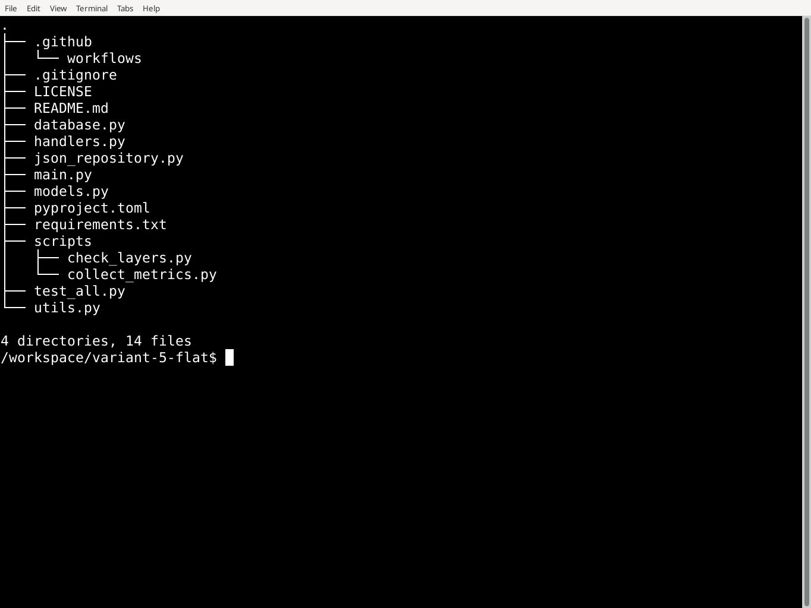

Рисунок 1. Flat: все production-модули и test_all.py находятся в корне.

В models.py собраны три сущности, снимок State и ошибки. Utils.py проверяет текст и целые числа. Handlers.py содержит бизнес-операции и напрямую создаёт SQLiteRepository либо JSONRepository. Main.py отвечает за argparse и вывод, database.py — за SQLite. Папки scripts и .github относятся к автоматизации, а не к слоям приложения.

Преимущество — короткие пути и мало файлов. Для небольшого приложения легко увидеть основные операции. Недостаток — handlers.py знает о конкретных адаптерах и STORAGE. Изменение способа сборки зависимостей затрагивает тот же файл, где находятся учебные операции.

Все тесты собраны в test_all.py. Проверены ограничения, неизвестные ID, дубликаты, изменение оценки, GPA, изоляция студентов, rollback SQLite, атомарная запись JSON, CSV и команды CLI. Итог: 50 тестов на каждом backend; покрытие SQLite 99,57%, JSON 100%.

Состояние до дополнений сохранено тегом flat-baseline: 45 тестов, покрытие 100%. Главная ветка сохраняет Flat, а выделение слоёв для задания B выполнено в отдельной ветке refactor/flat-to-modular.

## 3. Основная часть: запуск Flat и покрытие

Выполнен реальный запуск STORAGE=sqlite python -m pytest с обязательным порогом покрытия 80%. Все 50 тестов прошли; показаны фактический процент и результат команды.

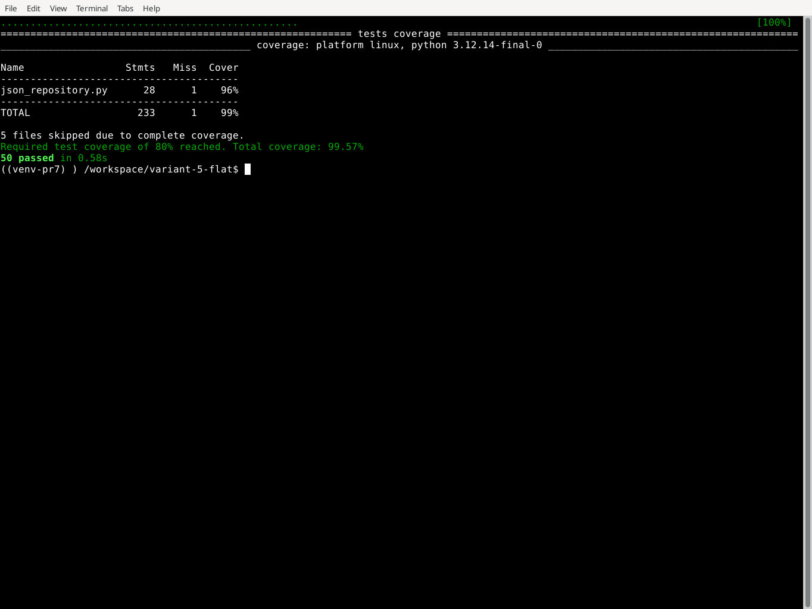

Скриншот выполнения: Flat, 50 passed, покрытие 99,57%.

## 4. Модульная структура и границы слоёв

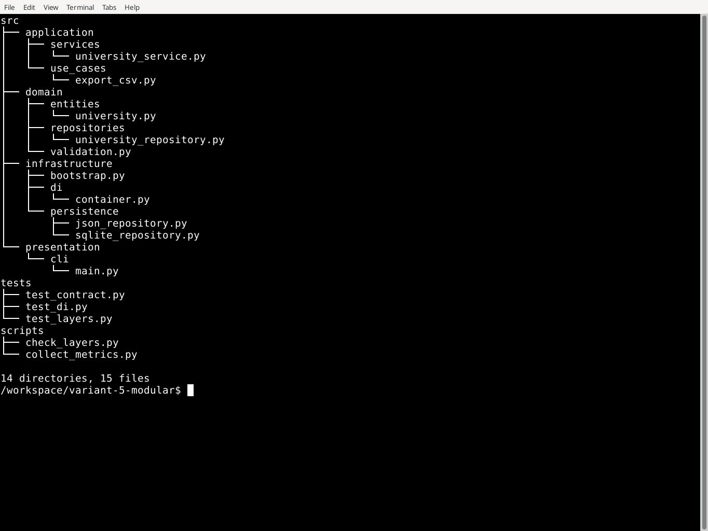

Рисунок 2. Modular: четыре слоя, отдельные тесты и средства проверки.

Domain содержит Student, Course, Grade, State, ошибки, проверки и абстрактный UniversityRepository. Application реализует UniversityService и сценарий export_to_csv. Infrastructure содержит SQLite/JSON, DI-контейнер и composition root. Presentation принимает команды и показывает результат.

Правило зависимостей: domain не импортирует внешние слои; application зависит от domain; конкретные адаптеры подключаются при сборке. Сервис получает UniversityRepository извне и не читает переменные окружения. Main.py в корне сохраняет обычную точку входа.

Тесты разделены на поведенческий контракт, DI и проверку архитектуры. Всего 63 теста на каждом backend; покрытие SQLite 99,29%, JSON 99,65%. Дополнительные 13 тестов проверяют контейнер и границы, поэтому напрямую сравнивать итоговое время 50 и 63 тестов как стоимость архитектуры некорректно.

SQL-адаптер использует связанные таблицы students/courses/grades, внешние ключи и транзакцию. JSON записывает временный файл и атомарно заменяет целевой. Снимки неизменяемы. Контракт предназначен для одного локального владельца, без параллельных несогласованных писателей.

## 5. Основная часть: запуск Modular и покрытие

Выполнен запуск Modular на JSON. В терминале видны 63 успешных теста и проверка порога покрытия 80%.

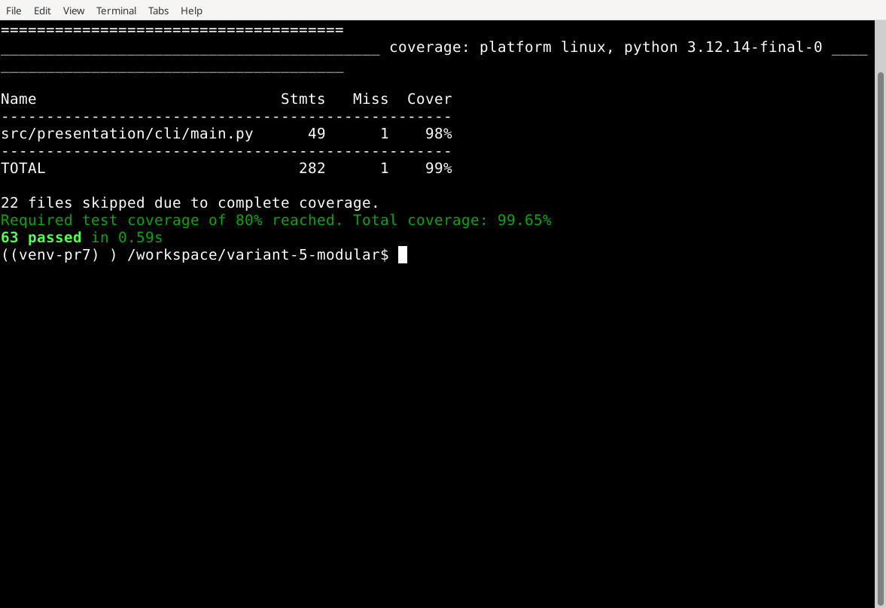

Скриншот выполнения: Modular, 63 passed, покрытие 99,65%.

## 6. Метрики и три эксперимента

| Метрика | Flat | Modular |
|---|---|---|
| Файлов .py всего | 9 | 28 |
| Production .py | 6 | 23 |
| Каталогов всего / приложения | 4 / 0 | 19 / 12 |
| LOC всех .py | 766 | 944 |
| LOC production | 333 | 413 |
| Максимальный файл, LOC | 284 | 284 |
| Внутренних импортов (AST) | 9 | 20 |
| Средняя CC production | 3.057 | 2.733 |
| Тестов на backend | 50 | 63 |
| SQLite: coverage / время | 99,57% / 0,992 с | 99,29% / 1,203 с |
| JSON: coverage / время | 100% / 0,588 с | 99,65% / 0,801 с |

LOC — физические строки, включая пустые и комментарии. .py всего включает тесты/скрипты; CC считается только по production-блокам radon. Каталоги считаются без .git, venv и кэшей. Максимальный файл в обоих проектах — общий контракт тестов (284 строки). Сырые данные и команды: docs/metrics-method.md и docs/evidence/.

| Эксперимент | Flat | Modular |
|---|---|---|
| Поиск enroll, три прогона, мс | 23.206 / 9.995 / 22.142 | 157.198 / 9.091 / 6.105 |
| Поиск: среднее, мс | 18.447 | 57.465 |
| CSV: изменено файлов | 3 | 4 (включая __init__.py) |
| CSV: автоматическая правка, мин | 0.0000665 | 0.0000734 |
| SQLite → JSON: файлов | 3: 2 существующих + 1 новый | 2: 1 существующий + 1 новый |
| Замена: автоматическая правка, мин | 0.0000120 | 0.0000057 |

Поиск: одинаковый rg по всем .py, три запуска. Время изменения охватывает автоматизированную запись файлов до линтера и тестов; это не скорость разработки человеком. После изменений тесты запускались отдельно. Исходные списки файлов и секунды сохранены в experiments.json. Миллисекундные различия не дают основания для вывода о скорости навигации человека.

Для исходного одинакового контракта 45 тестов: Flat — 275 LOC production, CC 2.967, 100%, 1.003 с; Modular — 303 LOC, CC 2.765, 99.49%, 1.032 с. Структура добавляет файлы и связи, но изолирует направления зависимостей.

## 7. Допзадание A: проверка границ слоёв

A. Check_layers.py разбирает AST, проверяет прямые и относительные импорты. Domain запрещены БД, CLI и внешние слои; application — конкретная инфраструктура. Временный коммит 99a8d7a добавил sqlite3 в domain. Запуск Actions 44277479634 завершился на check_layers.py с кодом 1. Коммит b4492b7 убрал нарушение; затем CI прошёл. Логи и снимок: docs/evidence/layers-ci-failed.log и docs/pr7-images/04-layer-violation.png.

Дополнительно выполнена проверка временной копии: корректная структура даёт код 0, импорт sqlite3 из domain — код 1, после удаления нарушения снова код 0.

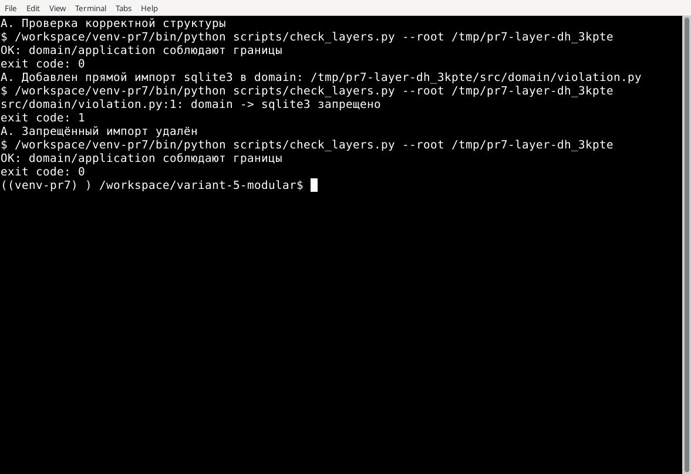

Скриншот выполнения A: нарушение обнаружено, после исправления проверка проходит.

## 8. Допзадание B: рефакторинг Flat → Modular

B. В Flat последовательно выделены domain (292a0fa), application (bdf2671), infrastructure (137643a), presentation (254e4df). Каждый шаг — отдельный коммит и 45 успешных тестов. До/после: production LOC 275 → 343, CC 2,967 → 2.694, coverage 100% → 99,53%. Промежуточные совместимые импорты позволили не менять исходный контракт. Ветка и тег refactor-complete сохранены; main оставлен плоским для сравнения.

Для повторной проверки из тега refactor-complete распакована отдельная копия проекта. В окне терминала показаны четыре коммита выделения слоёв и непосредственный запуск 45 исходных тестов.

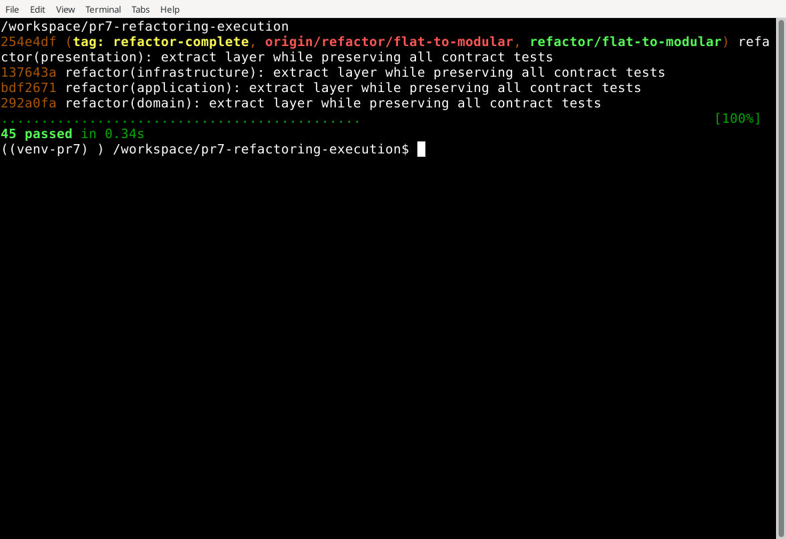

Скриншот выполнения B: четыре коммита и 45 passed в исторической версии.

## 9. Допзадание C: DI-контейнер

Контейнер в src/infrastructure/di/container.py регистрирует фабрики, разрешает зависимости, обнаруживает циклы и поддерживает временную подмену через override. Build_container регистрирует UniversityRepository и UniversityService, а CLI получает собранный сервис. Тесты подменяют порт через контейнер на create_autospec; файлы и БД не создаются.

DIP: сервис и адаптер зависят от абстракции domain. ISP: порт содержит только необходимые load/save снимка; SQL-соединение, CLI и экспорт не включены. Для многопользовательской БД такой снимочный контракт потребовал бы пересмотра.

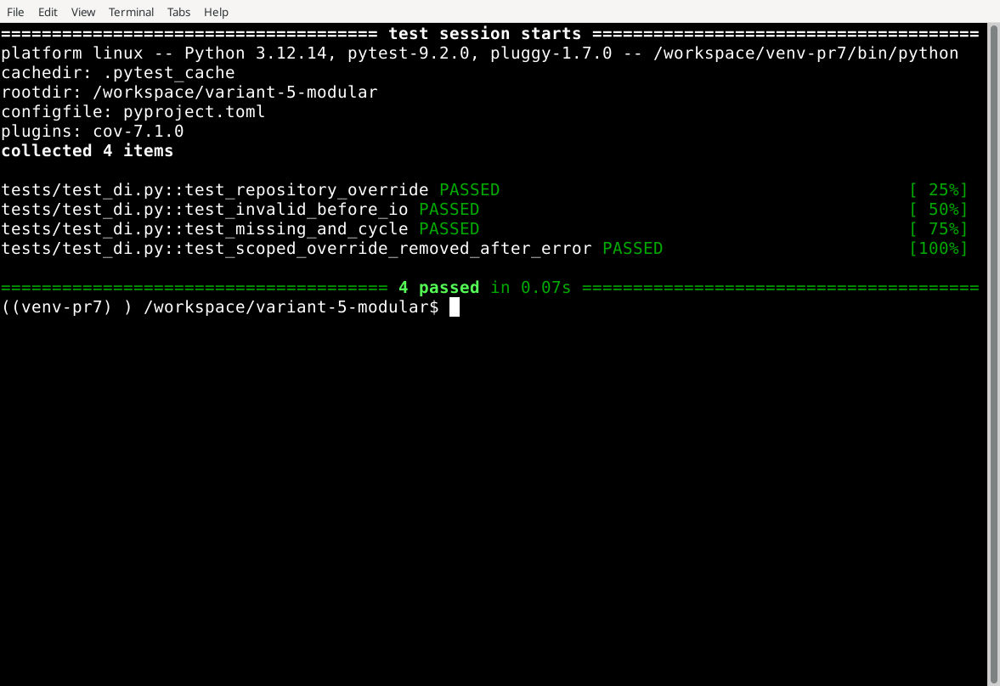

Скриншот выполнения C: все 4 DI-теста завершились PASSED.

## 10. Допзадание D: выполнение команд построения C4

Из исходников DOT выполнено построение обеих требуемых C4-диаграмм. В терминале видны команды dot -Tpng для Level 2 и Level 3, а также созданные файлы. Сами две диаграммы приведены на следующей странице как результат именно задания D.

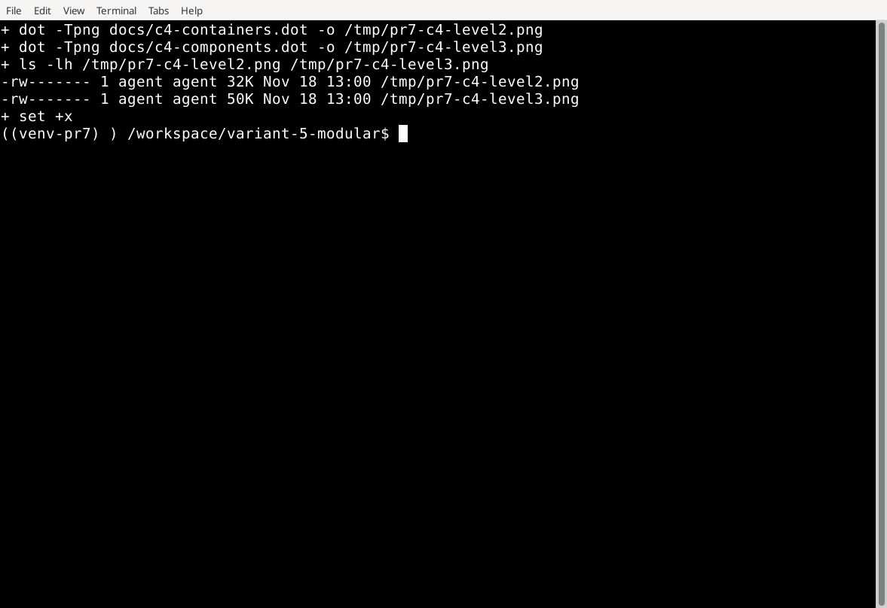

Скриншот выполнения D: построены файлы C4 Level 2 и Level 3.

## 11. Допзадание D: требуемые C4 Level 2 и Level 3

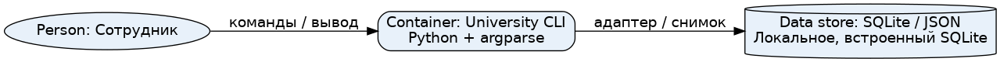

Рисунок 3. C4 Level 2: пользователь, один Python-процесс и локальные данные.

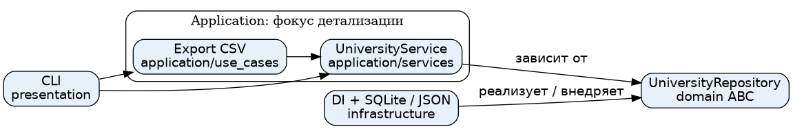

Рисунок 4. C4 Level 3: детализация application и связи с соседними компонентами.

Слои являются частями одного процесса, а не четырьмя независимо развёртываемыми приложениями. SQLite встроен в процесс; JSON — альтернативный локальный файл. Mermaid-исходники и описание взаимодействий находятся в docs/architecture.md.

## 12. Допзадание E: запуск radon и pydeps

Графы построены pydeps 3.0.9 с неограниченной глубиной (--max-bacon 0), сложность — radon 6.0.1. Сохранены PNG, DOT, pydeps.json и отчёты radon. AST и pydeps имеют разные правила агрегирования: узел __main__ в графе пакета — служебная точка анализа, не отдельный слой.

Повторно запущен radon для бизнес-сервиса и pydeps для пакета src. На скриншоте видны оценки методов, средняя сложность именно выбранного сервиса и созданный PNG. Это отдельный запуск; общая метрика всего production-кода приведена в сравнительной таблице.

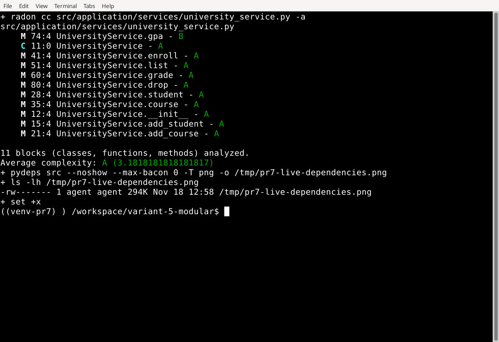

Скриншот выполнения E: radon cc, pydeps и созданный файл графа.

## 13. Допзадание F: CI и комментарии с метриками

F. Workflow metrics.yml в обоих репозиториях запускает pytest-cov с порогом 80%, radon и проверку структуры/слоёв, использует матрицу sqlite/json. Артефакты metrics-sqlite и metrics-json содержат метрики, coverage и JUnit. Бот публикует в PR фактические покрытие, число тестов, CC, импорты и время. Для Flat проверка честно сообщает об отсутствии слоёв; наличие DIP ей не приписывается.

![Скриншот F: фактические комментарии github-actions[bot] в PR, отдельно SQLite и JSON.](docs/pr7-images/06-pr-metrics.png)

Скриншот F: фактические комментарии github-actions[bot] в PR, отдельно SQLite и JSON.

## 14. Допзадание F: падение проверки в GitHub Actions

Намеренное нарушение зафиксировано отдельным коммитом. В сохранённом выводе реального запуска Actions показаны запрещённый импорт и завершение с кодом 1 для обоих backend. После исправления CI прошёл.

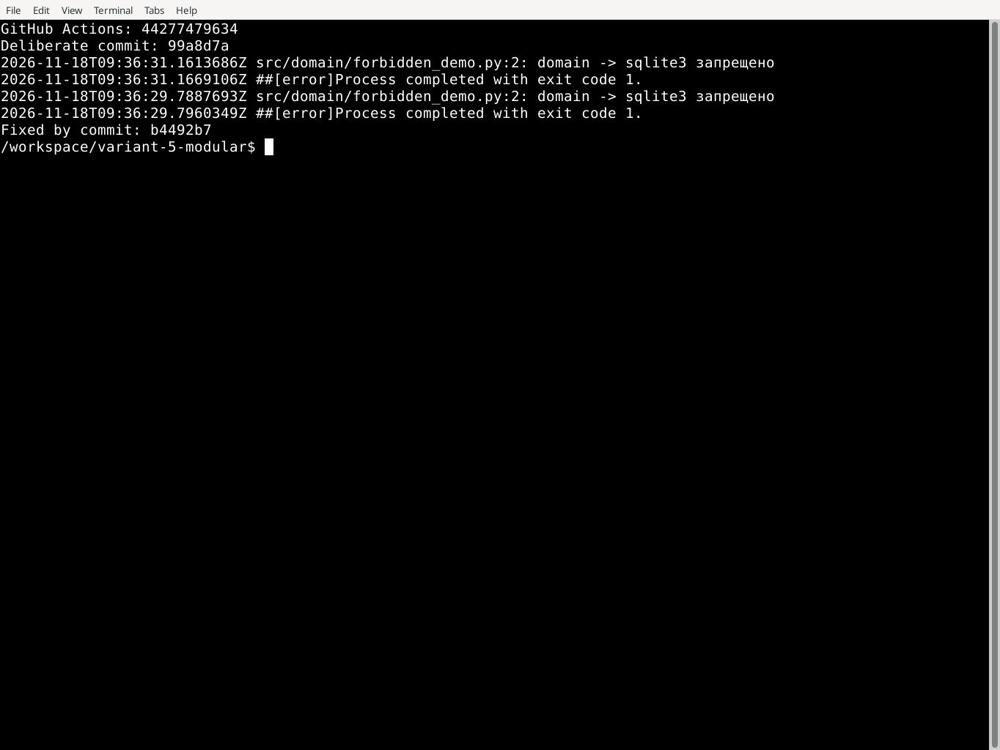

Скриншот F: зафиксированное падение CI на проверке слоёв.

Полные оригинальные журналы — docs/evidence/layers-ci-failed.log; успешные запуски и таблица тестов — docs/evidence/tests-summary.txt.

## 15. Допзадание G: выполнение операций на SQLite

G. В Modular добавлен JSONRepository и изменён только существующий bootstrap.py: бизнес-сервис не затронут. Итого два файла с учётом нового адаптера. Во Flat изменены handlers.py, конфигурация coverage и добавлен json_repository.py — три файла. Оба backend проходят один и тот же контракт. Переключение не переносит существующие данные автоматически.

Запущены add-student, add-course, enroll, grade, gpa, list, export и drop. Для каждого вызова видны фактический вывод и код завершения.

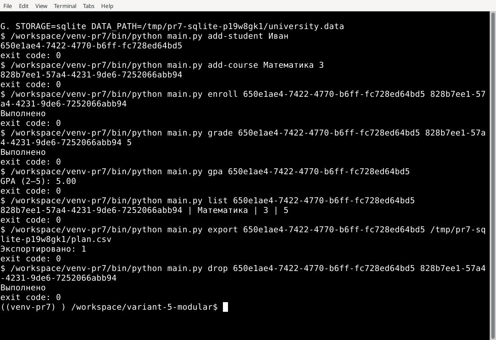

Скриншот выполнения G: STORAGE=sqlite, операции и успешные exit code 0.

## 16. Допзадание G: те же операции на JSON

С тем же бизнес-сервисом изменена только настройка STORAGE=json. Повторены те же команды, включая запись оценки, расчёт GPA, CSV-экспорт и удаление записи на курс.

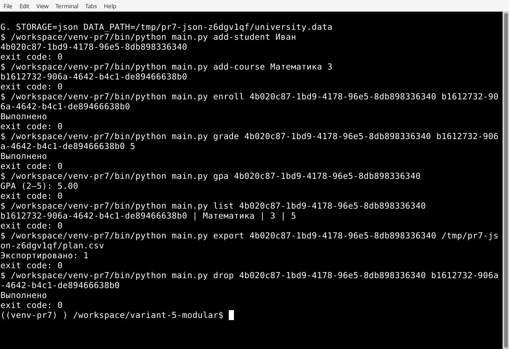

Скриншот выполнения G: STORAGE=json, те же операции и результаты.

## 17. Трудности, решения и выводы

Трудности и решения. При выделении слоёв использованы временные совместимые модули. Чтобы сравнение не исказили дополнительные DI-тесты, исходные и итоговые метрики разделены. Для pydeps использованы абсолютные пути вывода, так как при анализе пакета меняется рабочий каталог. Репозитории созданы владельцем из-за ограничения GitHub-интеграции на createRepository.

Выводы. Flat удобен для небольшого скрипта или короткого прототипа: меньше файлов, проще первый просмотр. Modular требует больше структуры, но лучше отделяет изменения инфраструктуры и облегчает изолированные проверки. В данном проекте для дальнейшего развития предпочтителен Modular: замена адаптера не затронула бизнес-сервис. Измерения не доказывают универсального ускорения разработки; основной результат — управляемые зависимости и сохранение поведения.

## 18. Ответы на контрольные вопросы

1. Чем отличаются Flat и Modular? В Flat модули лежат рядом и группируются по файлам. В Modular ответственность разделена по пакетам и слоям с заданными направлениями зависимостей.

2. Зачем четыре слоя? Domain задаёт сущности и правила; application — операции; infrastructure — технические адаптеры; presentation — взаимодействие с пользователем. Такое разделение уменьшает число причин изменения каждого слоя.

3. Каково правило зависимостей? Domain не знает о внешних слоях, application зависит от domain. Обратные зависимости создают связанность и затрудняют замену БД; циклы мешают импорту и тестированию.

4. Почему порт в domain, а реализация в infrastructure? Domain определяет необходимый контракт, не зависящий от SQL или файлов. Адаптер реализует его техническими средствами. Это направляет зависимости к абстракции.

5. Как структура влияет на тестируемость? Сервис с внедрённым портом проверяется mock-репозиторием без файлов. Flat тоже можно тестировать, но жёсткая связь с БД чаще требует интеграционного окружения.

6. Как влияет на добавление функции? Flat требует меньше переходов в небольшом проекте. Modular добавляет файлы, но локализует новую ответственность. Экспорт потребовал 3 и 4 файла соответственно; меньший счётчик сам по себе не означает лучшую архитектуру.

7. Какие метрики полезны? LOC, размер файлов, число модулей/каталогов, внутренние импорты, CC, coverage, число и время тестов; дополнительно — какие существующие слои меняются при расширении.

8. Когда Flat предпочтительнее? Для разового скрипта, учебного прототипа и небольшого инструмента с коротким сроком жизни, когда цена дополнительной структуры превышает пользу.

9. Что такое цикломатическая сложность? Число независимых путей выполнения: базовый путь плюс точки ветвления. Radon разбирает AST и оценивает функции/методы; большее значение обычно требует больше тестовых случаев.

10. Как связаны структура и SOLID? SRP поддерживается разделением ответственности, OCP — добавлением адаптеров без изменения сервиса, DIP — портом, ISP — узким контрактом. LSP требует, чтобы SQLite и JSON сохраняли поведение одного контракта; это проверяется тестами.

Проверка: STORAGE=sqlite python -m pytest -q --cov --cov-fail-under=80; затем тот же запуск с STORAGE=json. Скриншоты 1–17 и журналы — в docs/pr7-images и docs/evidence. Основные PR реализации: variant-5-flat/pull/1 и variant-5-modular/pull/1.
