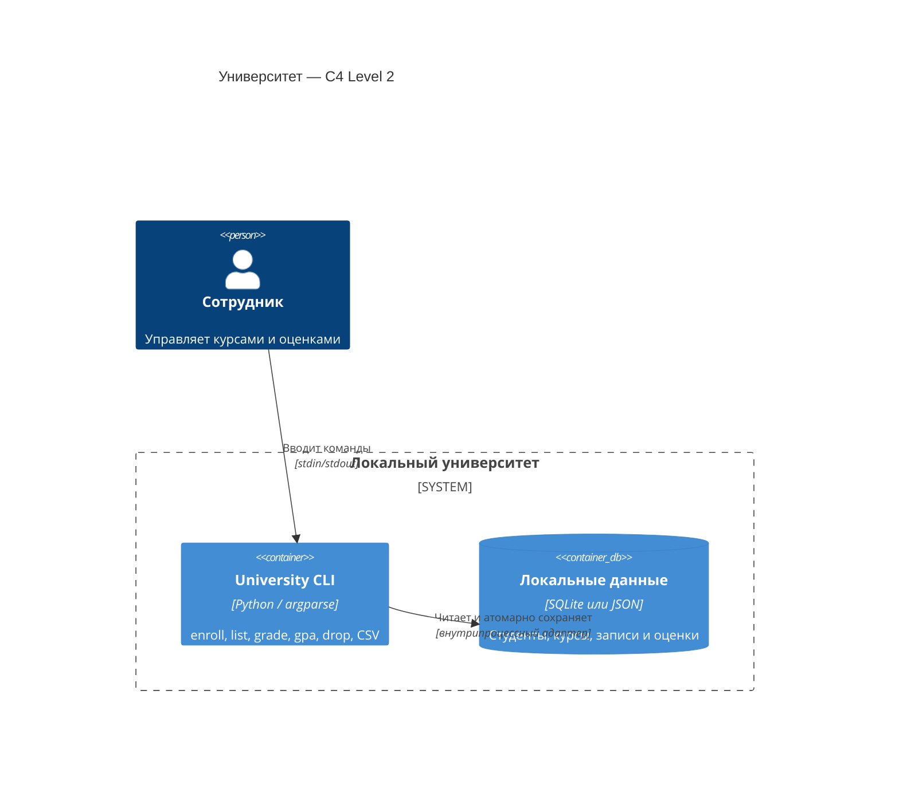
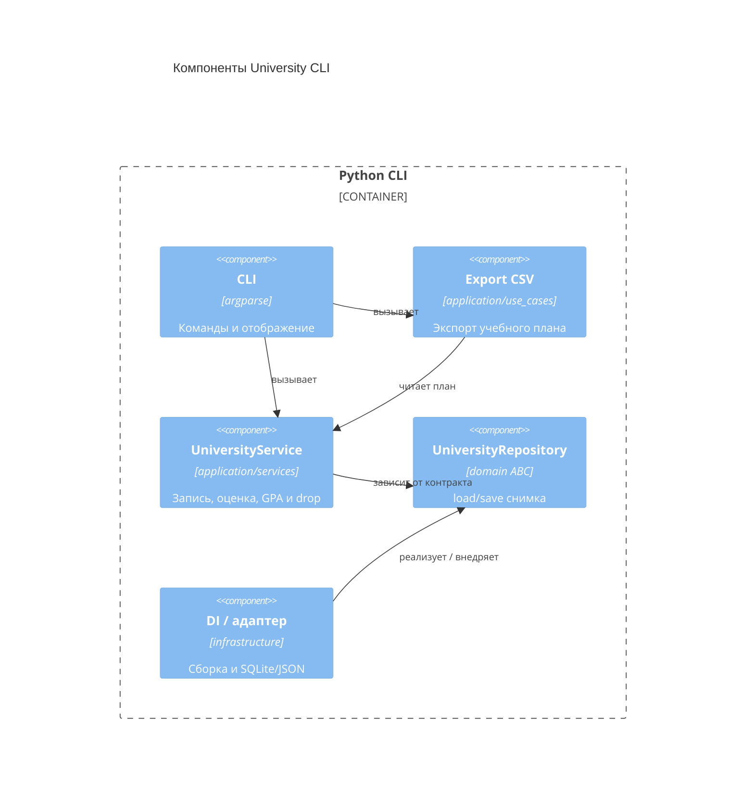

# Архитектура университета

## C4 Level 2 — Containers

Пользователь (студент/сотрудник) запускает Python CLI-приложение на своём компьютере. CLI, application, domain и адаптеры — компоненты одного процесса, а не четыре отдельно развёртываемых контейнера. SQLite — встроенный механизм и локальное хранилище; JSON — альтернативный локальный файл, не отдельный сетевой сервер.

## C4 Level 3 — Components (application)

Domain содержит Student/Course/Grade/State, ошибки, валидацию и узкий порт load/save. Application знает только domain; infrastructure реализует SQLite/JSON и DI; presentation вводит/выводит и вызывает сценарии. Root main.py сохраняет точку входа. Сборка выполняется через build_container(...).resolve(UniversityService). Сервис получает конкретный адаптер извне; бизнес-слой не читает STORAGE и не импортирует SQL/CLI.

DIP: обе стороны зависят от UniversityRepository. ISP: интерфейс состоит из двух операций, нужных сервису; в него не попали команды CLI, экспорт, соединения SQL или настройки окружения. load/save предназначен для одного локального владельца снимка, без параллельных писателей; для многопользовательской системы нужен другой транзакционный контракт.

A: AST-проверка запрещает domain импортировать application/infrastructure/presentation/SQL/CLI, а application — конкретную инфраструктуру. Учитываются алиасы, относительные импорты и динамический импорт. Python-анализатор не является полной песочницей; его задача — проверять правила обычного исходного кода в CI.
